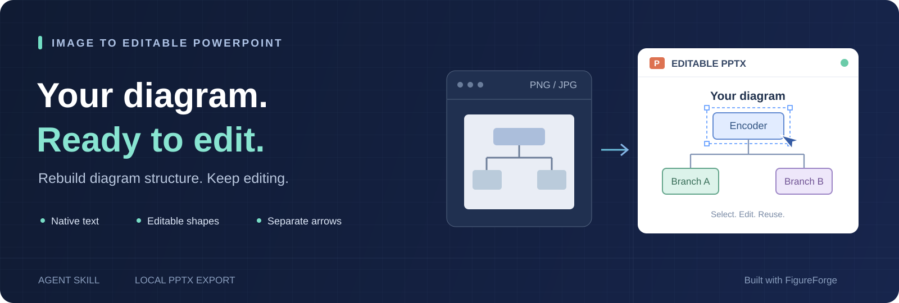
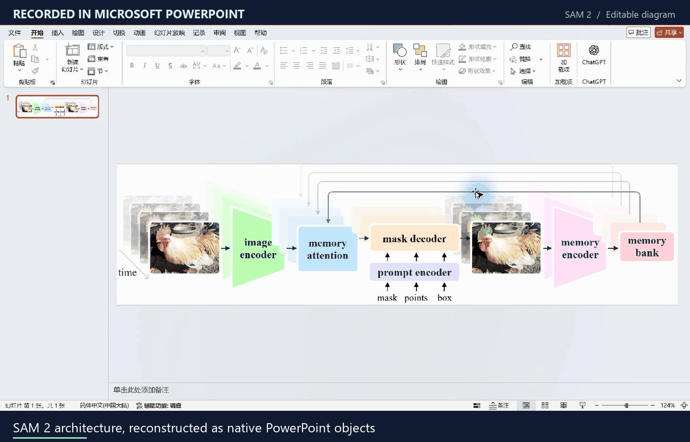
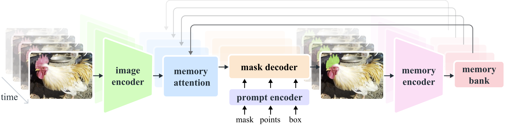
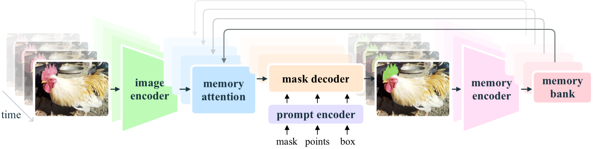
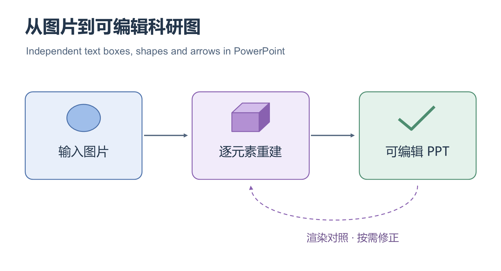

<div align="center">



# Image to Editable PowerPoint

**Reconstruct an existing diagram as PowerPoint objects you can keep editing.**

Visual understanding by your agent. Native PPTX export with a local FigureForge exporter.

[](https://github.com/moliflower/image-to-editable-ppt/actions/workflows/test.yml)
[](LICENSE)
[](#quick-start)
[](#quick-start)
[](SKILL.md)

**English** · [简体中文](README.zh-CN.md)

[Showcase](#showcase) · [Quick start](#quick-start) · [How it works](#how-it-works) · [FAQ](#faq) · [Contributing](CONTRIBUTING.md)

</div>

---

<a id="showcase"></a>

## See it edited in PowerPoint

The GIF below records edits in desktop Microsoft PowerPoint. It selects a text box, changes a label, moves an encoder shape, selects a feedback arrow, and selects all independent objects.



<div align="center">

[Download editable PPTX](examples/sam2/editable.pptx?raw=true) · [Inspect all-object selection](docs/assets/powerpoint-object-selection.png) · [Preview](examples/sam2/preview.png) · [Example and recording notes](examples/sam2/README.md)

</div>

### Public CV example: SAM 2 architecture

Reconstructed from the architecture image in [Meta's official SAM 2 repository](https://github.com/facebookresearch/sam2/blob/2b90b9f5ceec907a1c18123530e92e794ad901a4/assets/model_diagram.png). The diagram includes image and memory encoders, memory attention, prompt and mask decoders, and temporal feedback paths. Source attribution and Apache-2.0 license are retained with the example.

**58 independent objects · 50 native objects · 10 text boxes · 16 arrows · 8 photo crops**

<details>
<summary><strong>Compare the public reference and the reconstructed PPTX</strong></summary>

**Official reference image**



**Reconstructed PPTX, rendered by Microsoft PowerPoint**



[Scene JSON](examples/sam2/scene.json) · [Verification](examples/sam2/verification.json) · [Source and license](examples/sam2/README.md#source)

</details>

The animation uses captured desktop interaction states with English captions. The ribbon and selection handles are actual PowerPoint UI. Photo pixels remain images; text, modules, and arrows are separate native objects. Counts describe this example, not a general accuracy benchmark.

<details>
<summary><strong>Minimal export example: 17 objects</strong></summary>



[Download PPTX](examples/diagram.pptx?raw=true) · [Scene JSON](examples/diagram.scene.json)

This controlled example contains 17 objects, 6 text boxes, and 3 arrows. Use it to verify the exporter, audit, and rendering setup.

</details>

## Features and use cases

When all you have is a screenshot, a paper figure, or an old architecture image, a small change can mean redrawing the whole figure. This skill reconstructs the reference layout as independently selectable text boxes, shapes, and arrows.

| Capability | Result |
| --- | --- |
| Element-by-element reconstruction | Labels, containers, network blocks, and arrows become separate objects |
| Reference-based layout | Source aspect ratio, wording, spatial arrangement, and connection topology are preserved where reconstruction permits |
| Native PowerPoint output | DrawingML text, shapes, and paths that can be edited directly |
| Mixed visual content | Photographs, heatmaps, and complex textures remain separate image objects |
| Export verification | Independent package audit followed by actual PPTX rendering and visual review |
| Local exporter | No npm dependencies, network calls, or additional vision API key for export |

Designed for scientific method figures, model architectures, flowcharts, and diagrams built from text and geometric elements. The agent interprets the image and authors a scene JSON. The CLI exports that scene; it is not a standalone image-to-OCR command.

<a id="quick-start"></a>

## Quick start

### Requirements

- A vision-capable agent with skill support for image interpretation.
- **Node.js 18+** for PPTX export.
- **Python 3.10+ and Pillow** for image crops and the independent audit workflow.
- Optionally, **Microsoft PowerPoint on Windows** for the bundled rendering and edit-probe script. Creating the PPTX does not require Office. Other platforms can use an available PPTX renderer.

The agent client's account requirements and image-processing behavior are separate from the local exporter.

### Install the complete repository

**macOS / Linux**

```bash
git clone https://github.com/moliflower/image-to-editable-ppt.git "${CODEX_HOME:-$HOME/.codex}/skills/image-to-editable-ppt"
cd "${CODEX_HOME:-$HOME/.codex}/skills/image-to-editable-ppt"
python -m pip install -r requirements.txt
```

**Windows PowerShell**

```powershell
$skillRoot = if ($env:CODEX_HOME) { $env:CODEX_HOME } else { Join-Path $env:USERPROFILE '.codex' }
$skillPath = Join-Path $skillRoot 'skills/image-to-editable-ppt'
git clone https://github.com/moliflower/image-to-editable-ppt.git $skillPath
Set-Location $skillPath
python -m pip install -r requirements.txt
```

You can also [download the ZIP](https://github.com/moliflower/image-to-editable-ppt/archive/refs/heads/main.zip) and extract it into the skill directory. Keep `scripts/`, `references/`, and `vendor/` together with `SKILL.md`. If the destination already exists, see the [update instructions](docs/USAGE.md#update).

### Attach an image and ask

```text
Use $image-to-editable-ppt to reconstruct this image as an editable PPTX.
Preserve its wording, aspect ratio, and layout. Make text, modules, and arrows
independently editable. Return the PPTX and a preview rendered from that file.
```

Automatic skill discovery depends on your agent client. You can request a PNG-only reconstruction that does not inspect neighboring source files, or ask to preserve the source typography.

The skill produces a single-slide PPTX, a rendered preview when a renderer is available, and a retained scene JSON for revisions. Recognition uncertainties, raster regions, and incomplete visual checks are disclosed.

English scientific labels, numbers, and mathematical text default to Times New Roman. Explicit typography, template, or source-font preservation instructions override this default. Chinese and unsupported glyphs use an installed fallback.

<a id="how-it-works"></a>

## How it works

1. **Inspect** the image, zoom into dense regions, and identify text, geometry, layering, and arrow endpoints.
2. **Reconstruct** a pixel-coordinate scene with stable IDs for separate objects.
3. **Export** native DrawingML with the bundled, pinned FigureForge exporter.
4. **Audit** text, object counts, arrowheads, aspect ratio, and OOXML package integrity.
5. **Render and refine** the actual PPTX to check spacing, fonts, clipping, and directions.

Structural validation does not establish visual fidelity. Image understanding is performed by the current agent; the local scripts do not send an image to another vision service.

## Editability and limits

| Source content | PowerPoint output | What remains limited |
| --- | --- | --- |
| Titles and labels | Native text boxes | Font substitution can change spacing |
| Geometric shapes and modules | Independent native shapes | Complex modules may consist of several shapes |
| Lines and arrows | Native line/path objects | Not automatically attached to adjacent modules |
| Photos, heatmaps, complex artwork | Separate image objects | Internal content remains raster pixels |
| Equations | Editable text and positioned scripts | Not recovered as native Office equations |
| Charts in a bitmap | Reconstructed shapes and labels | Original data is not recovered |

Small labels, occlusion, unusual fonts, and low-resolution inputs require extra review. Subtle textures, shadows, and typography may differ. The skill currently reconstructs one image per slide; it does not include an unattended batch-recognition service.

## Verify the local toolchain

From the repository root:

```bash
node scripts/export_pptx.mjs --scene examples/diagram.scene.json --output build/figure.pptx
python -X utf8 scripts/audit_pptx.py --pptx build/figure.pptx --scene build/figure.exported.scene.json --report build/audit.json
```

On Windows with PowerPoint:

```powershell
powershell -NoProfile -File scripts/render_powerpoint.ps1 -InputPptx build/figure.pptx -OutputPng build/figure.png -Width 1600
```

See the [usage guide](docs/USAGE.md) for crop preparation, updating, rendering, and troubleshooting, or the [scene schema](references/scene-schema.md) for fields and supported objects.

<a id="faq"></a>

## FAQ

**Is the slide just a flattened image?** Text, diagram modules, and arrows are native objects. Declared photo/artwork regions may remain images. The workflow prohibits using a full-slide bitmap with invisible text as a substitute for reconstruction.

**Do I need another API key or a GPU?** The exporter needs neither. Your existing agent handles visual understanding, so it must support images and skill execution.

**Can I share only `SKILL.md`?** Share the whole repository or ZIP. The instructions depend on the bundled scripts, references, and exporter.

**Why is the skill not showing up?** Check that the path ends in `skills/image-to-editable-ppt/SKILL.md`, with no extra ZIP nesting, and check any custom `CODEX_HOME`. Reload skills using your client's supported mechanism, or start a new session and invoke `$image-to-editable-ppt` explicitly.

**Does local export mean my image never leaves my computer?** The repository scripts make no network requests. Image handling by the agent client depends on that client.

## Documentation and contributions

- [Usage guide](docs/USAGE.md): installation, export, crop preparation, rendering, troubleshooting.
- [Skill instructions](SKILL.md): the agent's full reconstruction workflow.
- [Scene schema](references/scene-schema.md): coordinates, text, paths, gradients, and images.
- [Contributing](CONTRIBUTING.md): reporting problems, sharing examples, and validating changes.
- [Upstream provenance](references/UPSTREAM.md): pinned FigureForge version and adaptation details.

Report problems through [Issues](https://github.com/moliflower/image-to-editable-ppt/issues). A reference image, expected result, and environment details help reproduce a problem.

## Acknowledgments and license

Native PPTX export is based on [Top-Conf Figure Gallery / FigureForge](https://github.com/qwdwqfwq/topconf-paper-figure-gallery). Its original copyright and MIT license are retained in [vendor/figureforge/LICENSE](vendor/figureforge/LICENSE).

Skill instructions and wrapper code use the [MIT License](LICENSE). The public SAM 2 reference and its adapted example retain [Apache-2.0 source attribution and licensing](examples/sam2/README.md#source).
