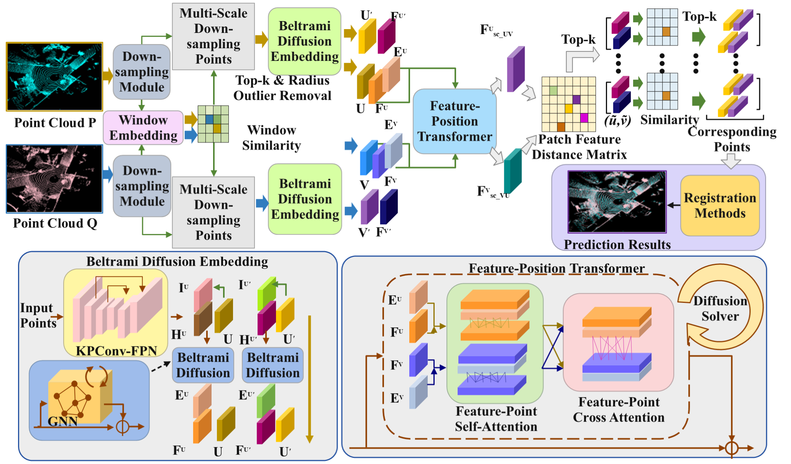
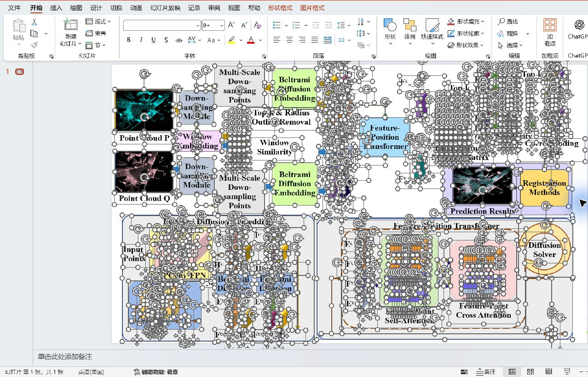
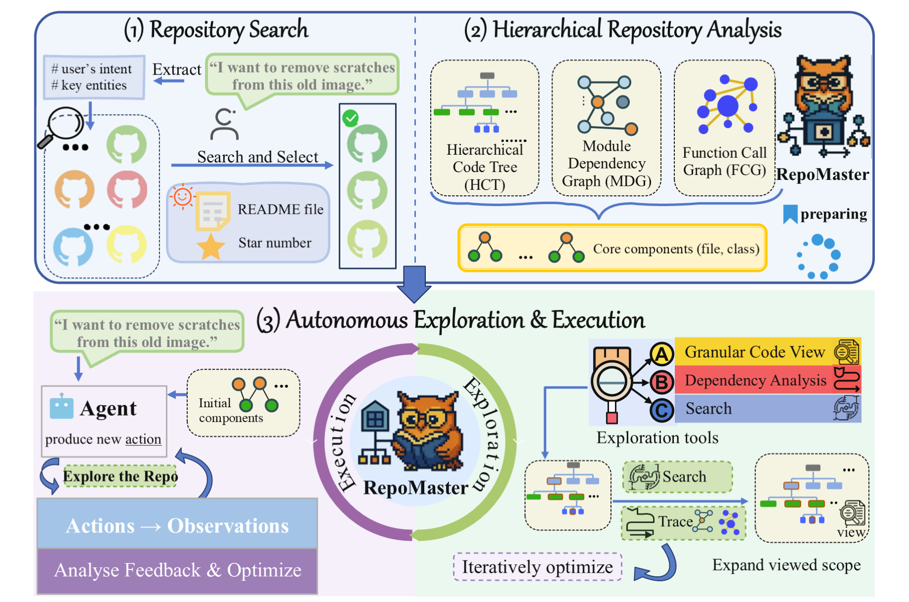
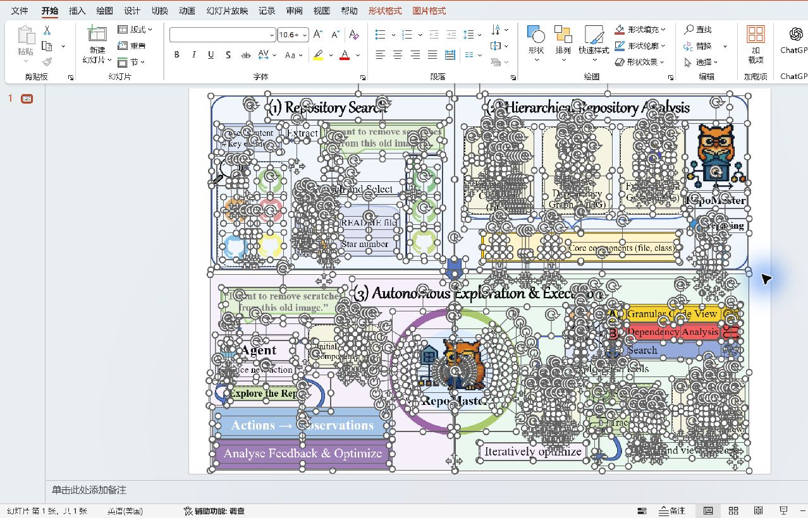

<div align="center">

# Image to Editable PowerPoint

**Reconstruct an existing diagram as PowerPoint objects you can keep editing.**

[](https://github.com/moliflower/image-to-editable-ppt/actions/workflows/test.yml)
[](LICENSE)
[](SKILL.md)

**English** · [简体中文](README.zh-CN.md)

[Showcase](#showcase) · [Install](#installation) · [Usage](#usage) · [Update](#update)

</div>

---

<a id="showcase"></a>

## From image to editable PowerPoint

### PosDiffNet · AAAI 2024

Feature tensors, similarity matrices and attention paths, reconstructed from [PosDiffNet, Figure 1](https://doi.org/10.1609/aaai.v38i1.27775) by She et al.

**Reconstructed figure**



**All objects selected in PowerPoint**



478 independent objects, including editable labels, matrix cells, feature faces and paths. Only the three point-cloud views remain images.

### RepoMaster · NeurIPS 2025

Repository trees, dependency graphs and a circular workflow, reconstructed from [RepoMaster, Figure 1](https://arxiv.org/abs/2505.21577) by Wang et al.

**Reconstructed figure**



**All objects selected in PowerPoint**



353 independent objects. Text, graph nodes, modules and routes remain editable; 16 complex logos and illustrations stay as separate images.

### Watch it edited · SAM 2

Select a label, change its text, move a module and select an arrow in desktop PowerPoint.


## Features

- Editable text, shapes, matrices and arrows.
- Reference layout, wording and colors preserved.
- Scientific labels with mixed styles and superscripts/subscripts.
- PowerPoint output with a rendered preview.

<a id="quick-start"></a>
<a id="installation"></a>

## Installation

### Let your agent install it

Copy this into your agent:

```text
Install this skill using its INSTALL.md:
https://github.com/moliflower/image-to-editable-ppt
```

Your agent handles setup. [Installation guide for agents →](INSTALL.md)

<details>
<summary>Manual installation</summary>

Run in your agent's skills directory:

```bash
git clone https://github.com/moliflower/image-to-editable-ppt.git
cd image-to-editable-ppt
python -m pip install -r requirements.txt
```

Requires Node.js 18+ and Python 3.10+. [Preview setup](references/rendering.md).

</details>

<a id="usage"></a>

## Usage

Attach an image and say:

```text
Convert this image to PPT.
```

You get an editable PowerPoint file and a preview.

<a id="update"></a>

## Update

Ask your agent:

```text
Update my image-to-editable-ppt skill.
```

Or run in the skill directory:

```bash
git pull
```

## Editability

Text, diagram shapes and connecting paths are separate PowerPoint objects. Photos and detailed illustrations remain separate images. Formulas and bitmap charts are reconstructed as text and geometry; source data is not recovered.

## Contributing

Issues and pull requests are welcome! Share a bug report, suggest an improvement or contribute a fix.

[Open an issue](https://github.com/moliflower/image-to-editable-ppt/issues) · [Submit a pull request](https://github.com/moliflower/image-to-editable-ppt/pulls)

## Acknowledgments

Built with [FigureForge](https://github.com/qwdwqfwq/topconf-paper-figure-gallery). [MIT License](LICENSE) · [Upstream notices](vendor/figureforge/UPSTREAM.md).

Figure credits: [PosDiffNet](https://github.com/moliflower/image-to-editable-ppt/blob/8230cbdffb3158fa165c0fe07a8962faeb071e3d/examples/posdiffnet/SOURCE.md), [RepoMaster](https://github.com/moliflower/image-to-editable-ppt/blob/8230cbdffb3158fa165c0fe07a8962faeb071e3d/examples/repomaster/SOURCE.md), [SAM 2](https://github.com/moliflower/image-to-editable-ppt/blob/8230cbdffb3158fa165c0fe07a8962faeb071e3d/examples/sam2/NOTICE.md). Original artwork retains its respective rights.
