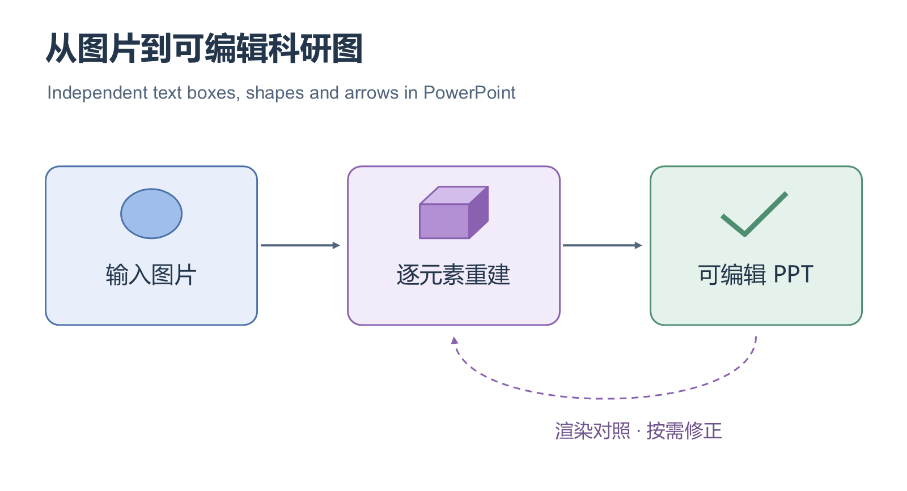

# 图片转可编辑 PPT · Image to Editable PowerPoint

一个面向 Codex 等支持 SKILL.md 的视觉智能体的 Skill：给它一张流程图、科研框架图或架构图，重建为 PowerPoint 中可分别修改的**文字框、形状和箭头**。

基于 [Top-Conf Figure Gallery / FigureForge](https://github.com/qwdwqfwq/topconf-paper-figure-gallery) 的原生 PPTX 导出器。识图由当前智能体完成，导出脚本完全在本地运行，无须额外的视觉模型 API Key。

[下载可编辑示例 PPTX](examples/diagram.pptx) · [查看场景 JSON](examples/diagram.scene.json) · [Skill 指令](SKILL.md)

这个示例包含 **17 个独立对象、6 个文字框、3 条箭头**，已通过 Microsoft PowerPoint 原生渲染和修改测试。它是导出能力的受控示例，不是自动识图准确率评测。

## 使用

安装到 Codex 的个人技能目录：

~~~sh
git clone https://github.com/moliflower/image-to-editable-ppt.git ~/.codex/skills/image-to-editable-ppt
~~~

如果配置了自定义 CODEX_HOME，将目录替换为其下的 skills/image-to-editable-ppt。Windows PowerShell 可使用：

~~~powershell
git clone https://github.com/moliflower/image-to-editable-ppt.git "$env:USERPROFILE/.codex/skills/image-to-editable-ppt"
~~~

在支持技能的对话中附上图片，输入：

> 使用 $image-to-editable-ppt 把这张图转成可编辑 PPT，保留布局，让文字、模块和箭头能单独修改。

也可自然表达“把这张图转成可编辑 PPT”。Skill 的自动选择已启用，具体发现方式由所用智能体客户端决定。

## 工作方式

1. 智能体查看原图，放大细节，识别文字、模块、箭头和层次关系。
2. 按原图像素坐标生成结构化场景，每个元素有独立 ID。
3. 使用随仓库固定版本附带的 FigureForge 导出器生成原生 DrawingML。
4. 独立检查 PPTX 中的文字、对象数、箭头、包结构和长宽比。
5. 渲染实际 PPTX，与原图核对并修正。

**这是由智能体执行识图的 Skill，不是将任意图片交给一个命令就自动 OCR 完成的独立转换器。** 命令行导出器接收已重建的场景 JSON。SKILL.md 指导智能体完成图片到场景的步骤。

## 可编辑范围

| 内容 | 输出 |
|---|---|
| 标题、标签、说明 | 原生文本框，可改内容、字号、字体、颜色 |
| 模块框、圆、多边形 | 独立原生形状，可移动、缩放、改填充和线条 |
| 直线、折线、曲线箭头 | 独立原生路径与箭头，可修改线条、几何和颜色 |
| 照片、复杂纹理和原始素材 | 独立图片对象，内部仍是像素 |
| 图表、公式 | 可用图形和文字重建，不代表恢复原始数据或原生公式结构 |

箭头不自动绑定到相邻模块，因此移动模块后可能需要调整箭头位置。低分辨率、密集标注、遮挡和特殊字体会影响复刻效果；对无法确认的内容会记录并披露。不会以整页底图加透明文字冒充可编辑图。

## 本地运行导出示例

需要 Node.js 18+、Python 3.10+。图片裁剪需要 Pillow：

~~~sh
python -m pip install -r requirements.txt
node scripts/export_pptx.mjs --scene examples/diagram.scene.json --output build/figure.pptx
python scripts/audit_pptx.py --pptx build/figure.pptx --scene build/figure.exported.scene.json
~~~

Windows 安装了 Microsoft PowerPoint 时，可以后台渲染并检查：

~~~powershell
powershell -NoProfile -File scripts/render_powerpoint.ps1 -InputPptx build/figure.pptx -OutputPng build/figure.png -Width 1600
~~~

PowerPoint 只用于最终渲染与验证，生成 PPTX 本身不需要 Office。其他平台可使用可用的 PPTX 渲染器；仅通过结构检查不能证明视觉还原准确。

场景格式、照片裁片和字体说明见 [scene-schema.md](references/scene-schema.md)。

## 开发与验证

~~~sh
node --test tests/test_export.mjs
python -m unittest discover -s tests -p "test_*.py"
~~~

测试覆盖中文原生文本、独立形状、曲线和箭头、照片裁片、无效输入拒绝、整页位图拒绝、OOXML 关系完整性以及被篡改文字的检测。GitHub Actions 运行结构和脚本测试，不运行 Microsoft PowerPoint。

可选的 Windows 修改验证会另存副本，不覆盖输入：

~~~powershell
powershell -NoProfile -File scripts/render_powerpoint.ps1 -InputPptx examples/diagram.pptx -OutputPng build/probe.png -EditProbePath build/edited-probe.pptx
~~~

## 来源与许可

MIT License。封装与技能指令版权归本项目贡献者所有。FigureForge 导出器及模板保留其原有 MIT 版权与许可，位于 [vendor/figureforge/LICENSE](vendor/figureforge/LICENSE)。

固定的上游版本、复用范围和适配说明见 [UPSTREAM.md](references/UPSTREAM.md)。本仓库不附带上游论文图片画廊，也不包含用户图片、API Key 或私人文档。

## English

An assistant skill for reconstructing an existing diagram as editable PowerPoint text, shapes, and arrows. It reuses FigureForge's native DrawingML exporter. The assistant interprets the reference image and writes a pixel-coordinate scene; local scripts create and audit the PPTX. No additional vision API key is required.

Install this repository as an agent skill and attach an image with: “Use $image-to-editable-ppt to rebuild this diagram as independently editable PowerPoint objects.”

Photographs remain separate raster objects. Native paths are editable but not automatically bound connectors. Recognition and visual fidelity require per-image review. The included example and tests validate export behavior, not arbitrary-image reconstruction accuracy.
