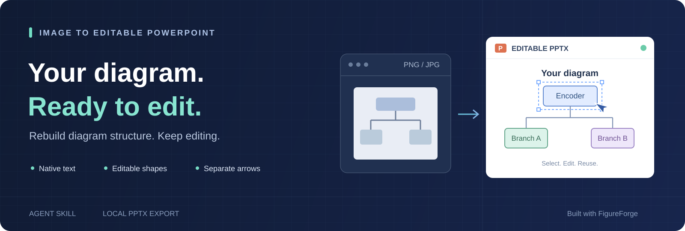
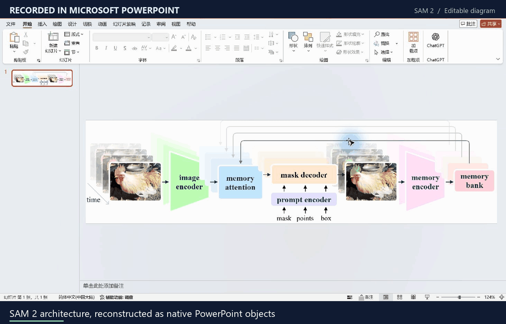
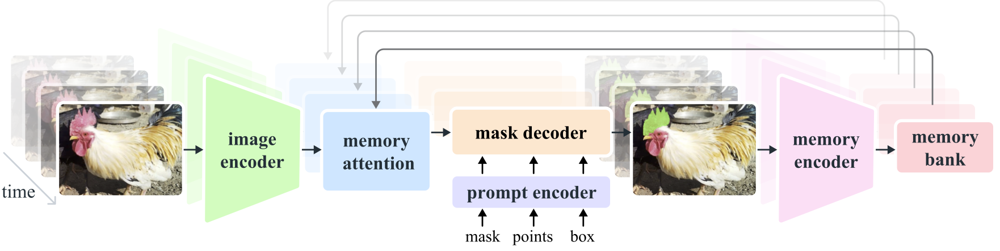
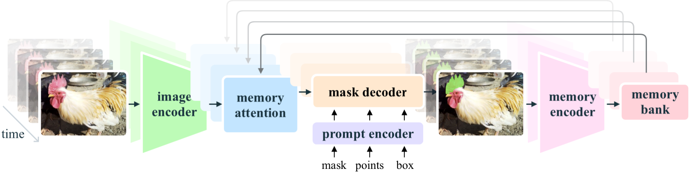
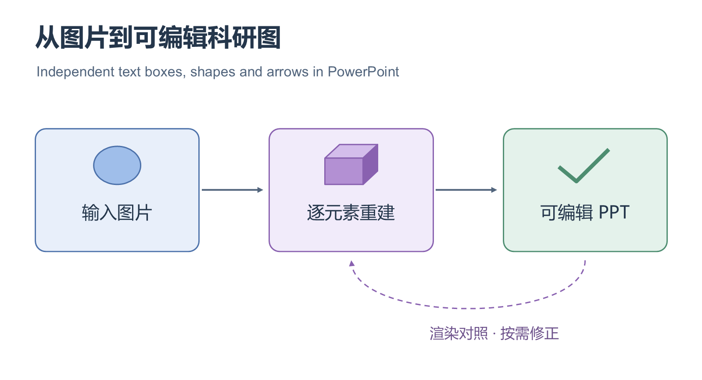
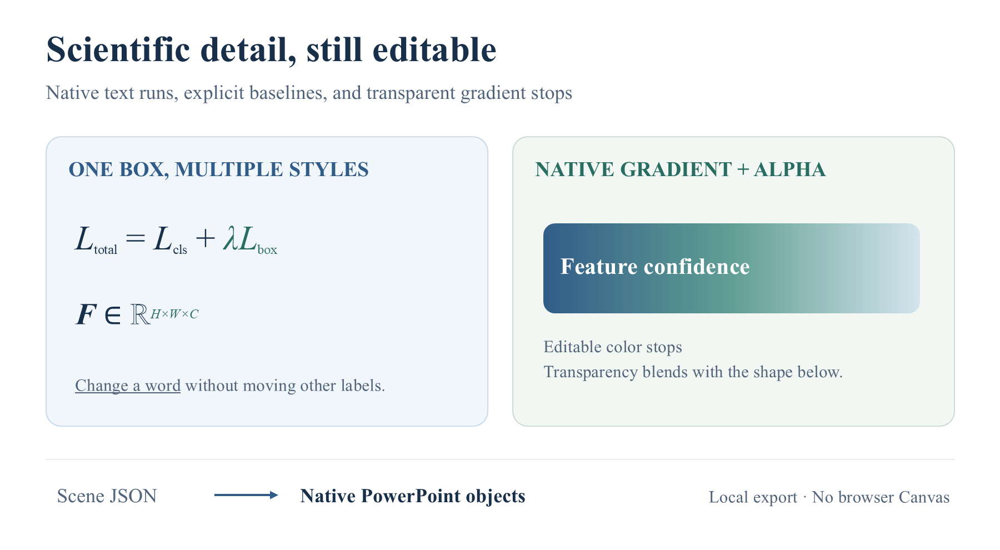
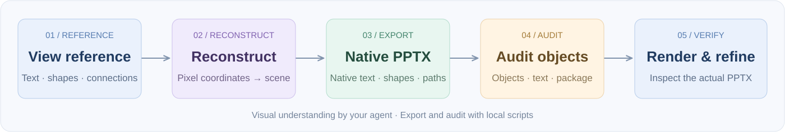

<div align="center">



# Image to Editable PowerPoint

**把流程图、科研框架图和架构图，重建成可以继续修改的 PowerPoint。**

由视觉智能体理解原图，使用本地 FigureForge 导出器生成原生文字框、形状与箭头。

[](https://github.com/moliflower/image-to-editable-ppt/actions/workflows/test.yml)
[](LICENSE)
[](#quick-start)
[](#quick-start)
[](SKILL.md)

[English](README.md) · **简体中文**

[效果展示](#showcase) · [快速开始](#quick-start) · [如何工作](#how-it-works) · [进阶用法](docs/USAGE.zh-CN.md) · [常见问题](#faq) · [参与贡献](CONTRIBUTING.md)

</div>

---

<a id="showcase"></a>

## 在真实 PowerPoint 中查看编辑效果

动图展示实际 PowerPoint 操作：选中文本框、修改标签、拖动编码器形状、单独选中反馈箭头，最后选中全部独立对象。边框与控制点来自真实的 PowerPoint 界面。



<div align="center">

[下载可编辑 PPTX](examples/sam2/editable.pptx?raw=true) · [查看全部对象的选中框](docs/assets/powerpoint-object-selection.png) · [高清预览](examples/sam2/preview.png) · [案例与录制说明](examples/sam2/README.md)

</div>

### 公开 CV 案例：SAM 2 架构图

参考图来自 [Meta 官方 SAM 2 仓库](https://github.com/facebookresearch/sam2/blob/2b90b9f5ceec907a1c18123530e92e794ad901a4/assets/model_diagram.png)，包含图像编码器、记忆注意力、提示与掩码解码器，以及时间维度的记忆反馈路径。示例目录保留来源说明和 Apache-2.0 许可证。

**58 个独立对象 · 50 个原生对象 · 10 个文本框 · 16 条箭头 · 8 个照片裁片**

<details>
<summary><strong>展开查看官方参考图与 PPTX 重建结果</strong></summary>

**官方参考图**



**Microsoft PowerPoint 实际渲染的重建结果**



[场景 JSON](examples/sam2/scene.json) · [核验记录](examples/sam2/verification.json) · [来源与许可证](examples/sam2/README.md#source)

</details>

动图由实际桌面操作画面组成，附有英文步骤说明。照片仍为图片；文字、模块和箭头是独立原生对象。上述类别有包含关系，不应直接相加，也不代表通用识别准确率。

<details>
<summary><strong>查看最小示例：17 个对象，快速验证导出环境</strong></summary>



[下载基础 PPTX](examples/diagram.pptx?raw=true) · [查看场景 JSON](examples/diagram.scene.json)

这个受控示例包含 **17 个独立对象、6 个文本框、3 条箭头**，适合先跑通导出、结构检查与 PowerPoint 渲染。它用于验证导出能力。

</details>

## 功能与适用场景

手里只有一张论文插图、流程截图或历史项目的架构图时，修改一个标签、移动一个模块，往往就要重新画图。本项目把参考图拆解为独立元素，保留布局和流程关系，让你在 PowerPoint 中继续编辑。

| 能力 | 你会得到什么 |
| --- | --- |
| **逐元素重建** | 标题、标签、框体、网络模块和箭头分别成为可选择的对象 |
| **保留原图结构** | 按图片像素坐标重建，沿用原图长宽比、内容顺序与连接关系 |
| **原生 PPTX** | 使用 DrawingML 文字、形状与路径，直接在 PowerPoint 中修改 |
| **混合图形处理** | 将照片、热图和复杂纹理保留为独立图片，周围的标签与流程仍可编辑 |
| **导出后检查** | 核对文字、对象、箭头及文件结构，再渲染实际 PPTX 检查显示效果 |
| **本地导出** | 导出脚本无 npm 依赖、无网络请求，不需要额外的视觉 API Key |

本地导出器支持 **双端箭头、自定义虚线间距，以及形状、路径和图片旋转**。新裁片会保留原图坐标与像素摘要，审计可回到原图逐项核验。字体、字号保持显式指定，不依赖浏览器 Canvas。参见[原生能力示例](examples/native-capabilities.scene.json)与[场景格式](references/scene-schema.md)。

### 科研标注保留在同一个文本框

同一文本框可以混排颜色、字体、粗斜体、下划线与**上下标**，修改标签时无需移动多个碎片。原生线性渐变支持色标透明度。独立审计会检查保存后的字号、字体、基线偏移及渐变参数，并继续核验图形与图片来源。



[下载可编辑示例](examples/scientific-text/editable.pptx?raw=true) · [场景与验证说明](examples/scientific-text/README.md) · [同类项目代码调研](references/related-projects.md)

这个原创能力示例含 18 个原生对象，其中 12 个文本框。上下标属于可编辑文字，不是原生公式对象；该示例用于展示新增能力，上面的 SAM 2 示例用于展示公开图片重建。

**适合**科研方法图、模型结构图、技术流程图，以及由文字、规则形状和箭头组成的示意图。识图由你正在使用的视觉智能体完成；本项目提供技能指令与本地导出工具，命令行接收的是重建后的场景 JSON。

<a id="quick-start"></a>

## 快速开始

### 1. 准备环境

| 依赖 | 用途 | 是否必需 |
| --- | --- | --- |
| 支持图片输入与 Skill 的智能体 | 查看原图、识别布局、构建场景 | 图片重建需要 |
| Node.js 18+ | 生成原生 PPTX | 必需 |
| Python 3.10+ 与 Pillow | 处理图片裁片，独立检查 PPTX | 完整工作流需要 |
| Microsoft PowerPoint（Windows） | 使用附带脚本渲染、验证编辑操作 | 可选；生成 PPTX 不需要 Office |

其他系统可使用可用的 PPTX 渲染器检查视觉效果。智能体自身的运行、账户与图片处理方式由所用客户端决定。

### 2. 安装完整技能目录

**macOS / Linux**

```bash
git clone https://github.com/moliflower/image-to-editable-ppt.git "${CODEX_HOME:-$HOME/.codex}/skills/image-to-editable-ppt"
cd "${CODEX_HOME:-$HOME/.codex}/skills/image-to-editable-ppt"
python -m pip install -r requirements.txt
```

**Windows PowerShell**

```powershell
$skillRoot = if ($env:CODEX_HOME) { $env:CODEX_HOME } else { Join-Path $env:USERPROFILE '.codex' }
$skillPath = Join-Path $skillRoot 'skills/image-to-editable-ppt'
git clone https://github.com/moliflower/image-to-editable-ppt.git $skillPath
Set-Location $skillPath
python -m pip install -r requirements.txt
```

也可以[下载 ZIP](https://github.com/moliflower/image-to-editable-ppt/archive/refs/heads/main.zip)，解压为技能目录中的 `image-to-editable-ppt/`。**分享或安装时请保留整个目录**，`scripts/`、`references/` 和 `vendor/` 都是必要内容。安装位置已存在时，参见[更新说明](docs/USAGE.zh-CN.md#update)。

### 3. 附上图片，描述要求

```text
使用 $image-to-editable-ppt 把这张图转成可编辑 PPT。
保留原图内容、长宽比和布局，让文字、模块和箭头可以分别修改。
完成后给我 PPTX 和实际渲染的预览图。
```

也可以直接说“把这张图转成可编辑 PPT”。是否自动发现技能取决于所用智能体客户端；遇到未识别的情况，参见[常见问题](#faq)。

通常会得到：

- **`figure.pptx`**：可在 PowerPoint 中继续修改的单页图。
- **预览图**：可用渲染器生成的实际显示结果。
- **保留的场景 JSON**：用于后续修订与重新导出，日常编辑无需手动修改它。

无法确认的文字、保留为位图的区域，以及未完成的渲染检查，会在交付时说明。

<details>
<summary><strong>更多可直接复制的提示词</strong></summary>

**只依据这张图片重建**

```text
只读取这张 PNG，不参考相邻的 draw.io、SVG、PDF 或其他源文件。
保留原图的文字、布局和箭头方向；无法看清的文字请标明，不要猜测。
```

**保留字体风格**

```text
把这张科研图重建为可编辑 PPT，尽量保留原图字体、配色与字号层次。
照片区域可以保留为图片，标题、模块和连接箭头需要独立可编辑。
```

**继续修改已生成的结果**

```text
基于刚才的可编辑 PPT，把“mask decoder”改为“your decoder”。
其余内容和布局保持不变，重新导出并检查文字有没有溢出。
```

默认英文科研标签、数字与数学文字使用 Times New Roman。用户指定字体、期刊模板或“保留原图字体”的要求优先；中文和缺失符号使用必要的字体回退。

</details>

<a id="how-it-works"></a>

## 如何工作



1. **看图与测量**：识别文字、模块、箭头端点、层次关系及需要保留的图片区域。
2. **构建场景**：以原图像素为坐标，为每个可编辑元素分配独立 ID。
3. **生成 PPTX**：使用随仓库固定版本附带的 FigureForge 导出器，写入原生 DrawingML。
4. **独立审计**：检查文字、对象数、箭头、长宽比和 OOXML 包结构。
5. **渲染与修正**：核对实际 PPTX 的字体、间距、裁切和箭头方向，再迭代调整。

识图与导出是两个明确的步骤：`SKILL.md` 指导智能体从图片重建场景，`export_pptx.mjs` 从场景生成文件。结构审计通过后，仍需要视觉检查才能判断复刻效果。

## 哪些内容可以编辑

| 原图内容 | PPT 中的形式 | 编辑范围 |
| --- | --- | --- |
| 标题、标签、说明文字 | 原生文本框 | 内容、字体、字号、颜色、位置 |
| 矩形、圆、多边形、网络模块 | 原生形状或多个独立形状 | 几何、填充、边框与布局 |
| 直线、折线、曲线与箭头 | 原生线条 / 路径 | 位置、路径、线型、颜色与箭头 |
| 照片、热图、复杂纹理 | 独立图片对象 | 位置与尺寸；图片内部仍为像素 |
| 数学公式 | 可编辑文字及手动排布的上下标 | 可改字符与排布，不自动恢复 Office 公式结构 |
| 位图中的数据图表 | 按内容重建的图形与文字 | 不自动恢复源数据或原生数据图表 |

箭头没有自动绑定相邻模块，移动模块后可能需要同步调整连线。低分辨率、密集标注、遮挡和特殊字体会增加重建难度。细微纹理、阴影与字形也可能存在差异。

## 在命令行验证导出

以下命令在**仓库根目录**执行，使用已提供的场景 JSON 验证本地工具链：

```bash
node scripts/export_pptx.mjs --scene examples/diagram.scene.json --output build/figure.pptx
python -X utf8 scripts/audit_pptx.py --pptx build/figure.pptx --scene build/figure.exported.scene.json --report build/audit.json
```

Windows 安装了 PowerPoint 时，生成实际预览：

```powershell
powershell -NoProfile -File scripts/render_powerpoint.ps1 -InputPptx build/figure.pptx -OutputPng build/figure.png -Width 1600
```

图片裁片准备、场景字段、后台渲染、编辑验证及故障排查，见[完整使用指南](docs/USAGE.zh-CN.md)和[场景格式](references/scene-schema.md)。

<a id="faq"></a>

## 常见问题

<details>
<summary><strong>是不是把一整张图片放进 PPT？</strong></summary>

文字、规则形状和箭头会重建成独立的原生对象。照片与复杂纹理可以作为图片保留，并明确说明范围。工作流禁止以整页底图加透明文字冒充可编辑图。

</details>

<details>
<summary><strong>需要额外的 API Key 或 GPU 吗？</strong></summary>

本地导出器不调用视觉模型，不需要额外的视觉 API Key，也没有 GPU 依赖。图片理解由当前智能体完成，因此仍需要具备看图能力的客户端。客户端本身的服务要求另行适用。

</details>

<details>
<summary><strong>只把 SKILL.md 发给别人就能使用吗？</strong></summary>

请分享整个仓库或 ZIP 包。`SKILL.md` 是工作指令，实际导出依赖 `scripts/`、`vendor/figureforge/` 和 `references/`，图片处理还需要安装 `requirements.txt` 中的依赖。

</details>

<details>
<summary><strong>安装后没有识别到技能怎么办？</strong></summary>

确认目录结构是 `skills/image-to-editable-ppt/SKILL.md`，没有多套一层 ZIP 目录，并核对是否设置了自定义 `CODEX_HOME`。再按客户端的技能刷新方式重新加载，或在新会话中显式使用 `$image-to-editable-ppt`。

</details>

<details>
<summary><strong>能完全还原吗？是否支持批量转换？</strong></summary>

每张图都需要识别与视觉核对，本项目不承诺任意图片的像素级一致，也没有附带一键批量识图服务。当前技能按一张参考图重建一页 PPTX；要处理多张图片，可以逐张重建并检查。

</details>

<details>
<summary><strong>本地导出会把图片上传到其他服务吗？</strong></summary>

随仓库提供的导出、裁片和审计脚本不发送网络请求。你把图片交给智能体时，客户端如何处理图片取决于该客户端；“本地导出”仅描述本仓库脚本的执行方式。

</details>

## 文档与贡献

| 入口 | 内容 |
| --- | --- |
| [使用指南](docs/USAGE.zh-CN.md) | 安装、更新、场景导出、图片裁片、PowerPoint 渲染、故障排查 |
| [技能指令](SKILL.md) | 智能体执行的完整重建与核验流程 |
| [场景格式](references/scene-schema.md) | 对象类型、像素坐标、字体、路径与图片嵌入 |
| [案例说明](examples/sam2/README.md) | 复杂图的输入范围、可编辑范围与真实文件统计 |
| [贡献指南](CONTRIBUTING.md) | 复现问题、提交示例、修改脚本与验证要求 |
| [上游与适配](references/UPSTREAM.md) | FigureForge 固定版本、复用范围与许可说明 |

欢迎通过 [Issues](https://github.com/moliflower/image-to-editable-ppt/issues) 反馈无法识别的内容、文字溢出或导出问题。提供参考图、预期结果和软件版本，会更容易定位原因。

## 致谢与许可

原生 PPTX 导出能力基于 [Top-Conf Figure Gallery / FigureForge](https://github.com/qwdwqfwq/topconf-paper-figure-gallery)。项目保留其版权与 MIT 许可证，固定版本与适配细节见 [UPSTREAM.md](references/UPSTREAM.md)。

技能指令和封装代码采用 [MIT License](LICENSE)。上游组件的许可证位于 [vendor/figureforge/LICENSE](vendor/figureforge/LICENSE)。示例图中的照片与其他源素材权利归各自权利人；代码许可不替代源素材的使用授权，详见[案例说明](examples/sam2/README.md#asset-notes)。
