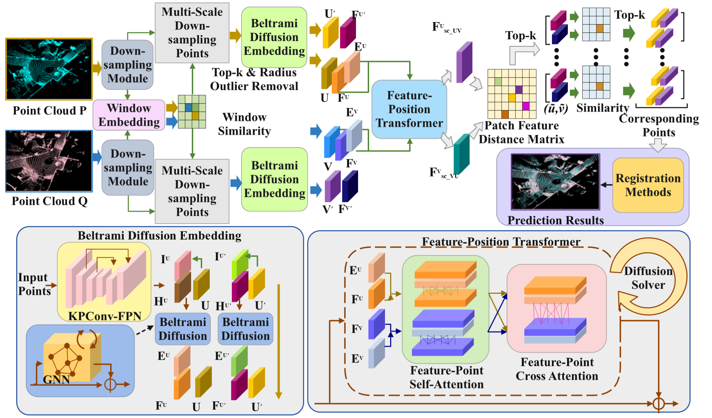

# PosDiffNet: an editable scientific figure

An editable reconstruction of the PosDiffNet architecture from Figure 1 of [She et al., AAAI 2024](https://doi.org/10.1609/aaai.v38i1.27775). See [source and attribution](SOURCE.md) for the original paper and the distinction between source artwork and this repository's code license.



[Editable PPTX](editable.pptx?raw=true) · [Original reference](reference.png) · [Scene JSON](scene.json) · [Verification](verification.json)

## What is editable

- **478 separate objects:** 475 native objects and 3 point-cloud images.
- **58 text boxes**, including 28 with native superscript/subscript runs.
- Matrix cells, the faces of feature blocks, module backgrounds, graph edges and paths are separate native objects.
- The three point-cloud crops are independently selectable images, verified against the reference pixels.

Counts describe this file, not recognition accuracy on other figures. Text boxes are included in the native-object count. Superscripts are editable text runs, not Office equation objects. Paths do not automatically reattach when a module moves.

## Verification and differences

The independent package audit passes. Microsoft PowerPoint rendered the actual PPTX at 2064 × 1212 pixels, and the preview was visually compared with the reference. No Computer Use session or desktop object-selection probe is required for this check.

The reconstruction retains the figure's wording, overall layout, module relationships and three point-cloud views. Small attention-mesh segments are illustrative redraws; shadows, rounded corners and some fine glyph geometry differ. Two conservative text-height warnings remain for compact multiline labels; the rendered labels were inspected and are visible without clipping.

## Reproduce

Run from the repository root:

```text
python examples/posdiffnet/rebuild.py
python -X utf8 scripts/build_figure.py --scene examples/posdiffnet/scene.json --source examples/posdiffnet/reference.png --output build/posdiffnet/editable.pptx --width 2064
```

The command uses the same portable exporter/audit and automatic renderer selection as ordinary figures. The screenshot supplied by the user identified the paper; a clear raster of the public figure was used for reconstruction, rather than its low-resolution screenshot thumbnail.
