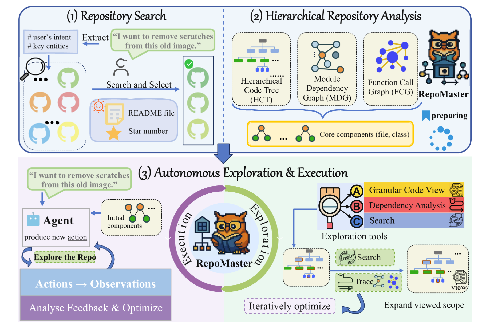

# RepoMaster: a second editable showcase

A reconstruction of the RepoMaster overview, Figure 1 of [Wang et al., NeurIPS 2025](https://proceedings.neurips.cc/paper_files/paper/2025/hash/98da9cdb7e8af9192f1fe2cb38690d60-Abstract-Conference.html). [Source and attribution](SOURCE.md).



[Editable PPTX](editable.pptx?raw=true) · [Reference PNG](reference.png) · [Scene JSON](scene.json) · [Verification](verification.json)

## Editable content

- **353 independent objects:** 337 native objects and 16 source-image crops.
- Text, section backgrounds, speech bubbles, tree nodes, dependency/call graphs, workflow arcs, simple icons and connecting paths are native objects.
- The 55 text objects include the separately rotated characters used for the circular “Execution” and “Exploration” labels.
- Complex GitHub marks, owl mascots and decorative tool icons remain individually selectable images. Their pixels are checked against the reference.

The reference is the user-supplied bitmap with the paper caption removed. The handwritten headings use Gabriola as an approximation; a machine without that font may substitute a different face. Fine hand-drawn outlines and minor decorative symbols differ. Paths do not automatically reconnect after moving nodes, and curved wording is edited character by character.

## Verification

The package audit passes with no export warnings. Microsoft PowerPoint rendered the actual PPTX at 1836 × 1218 pixels. The PNG was compared with the source for labels, section layout, graph-node placement, major route directions, object layering and retained artwork. The review corrected an initial-components label overlap and a search arrow hidden by a panel fill. No desktop clicking or Computer Use was used for this example.

## Reproduce

```text
python examples/repomaster/rebuild.py
python -X utf8 scripts/build_figure.py --scene examples/repomaster/scene.json --source examples/repomaster/reference.png --output build/repomaster/editable.pptx --width 1836
```

These are file-specific checks, not a general image-reconstruction benchmark. Source artwork retains its own rights; the repository code license does not replace them.
