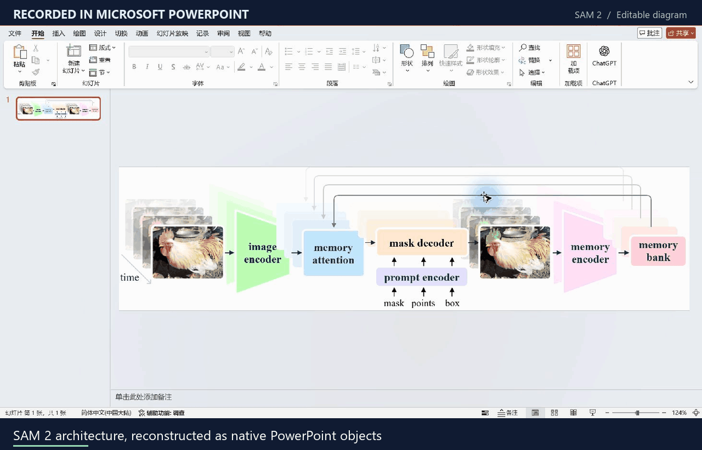
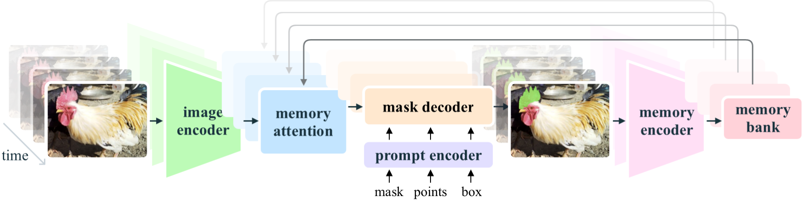

# SAM 2: public CV diagram reconstruction

[Home](../../README.md#showcase) · [Editable PPTX](editable.pptx?raw=true) · [Reference](reference.png) · [Preview](preview.png) · [Scene](scene.json)

This example reconstructs the official SAM 2 architecture diagram as a single editable PowerPoint slide. It demonstrates diagram reconstruction, not a model implementation or reproduction of SAM 2's scientific results.

## Watch the actual PowerPoint interaction



The demonstration was captured in desktop Microsoft PowerPoint. It shows:

1. Selecting the `mask decoder` text box and its native handles.
2. Selecting the word `mask` and changing it to `your`.
3. Selecting and dragging the image encoder shape independently.
4. Selecting the temporal feedback arrow as a separate native path.
5. Selecting all 58 objects, then restoring the clean reference layout.

The download retains the original diagram wording and layout. Demonstration edits were performed on a separate working copy and undone.

The GIF contains selected real interaction states, with adjusted playback durations, uniform resizing, and English captions outside the captured interface. The account/title strip was cropped out. Selection handles and edits were not drawn or simulated. The installed PowerPoint ribbon is Chinese; the figure, default project documentation, and animation captions are English.

[All-object selection screenshot](../../docs/assets/powerpoint-object-selection.png) · [Recording metadata](verification.json)

## Reconstruction details

| Item | Result |
| --- | --- |
| Input | Official 1762 × 444 PNG |
| Input boundary | Reconstructed from the PNG, without diagram source or model implementation |
| Output | One slide with the original aspect ratio |
| Independent objects | 58 |
| Native objects, including text and paths | 50 |
| Native text boxes | 10 |
| Arrow paths / lines | 16 |
| Photo crops | 8 |
| Preview renderer | Microsoft PowerPoint |

Text and arrow counts are included in the native-object count. These are per-file statistics, not reconstruction accuracy measurements.



All labels, modules, and connections are native objects. Eight photographic video-frame crops retain the original photographs, segmentation overlays, and faded frame appearance. The original serif labels are approximated with Times New Roman. Small rounded trapezoid corners are approximated by polygons, and faded native modules use pale solid fills. Paths do not automatically attach to neighboring modules.

Audit the example from the repository root:

```bash
python -X utf8 scripts/audit_pptx.py --pptx examples/sam2/editable.pptx --scene examples/sam2/scene.json --source examples/sam2/reference.png --report build/sam2-audit.json
```

<a id="source"></a>
<a id="asset-notes"></a>

## Source, attribution, and license

All eight photo nodes now retain verified source-crop provenance. The capability update preserves the previous PowerPoint render pixel-for-pixel. `photo-crop.png` is a crop of the same public reference used by the [native geometry example](../native-capabilities.scene.json); it retains this source attribution and license.

- **Project:** [SAM 2: Segment Anything in Images and Videos, AI at Meta / FAIR](https://github.com/facebookresearch/sam2).
- **Reference:** [`assets/model_diagram.png`](https://github.com/facebookresearch/sam2/blob/2b90b9f5ceec907a1c18123530e92e794ad901a4/assets/model_diagram.png).
- **Pinned source revision:** `2b90b9f5ceec907a1c18123530e92e794ad901a4`.
- **Source license:** [Apache License 2.0](SOURCE-LICENSE.txt), retained from the [official repository](https://github.com/facebookresearch/sam2/blob/2b90b9f5ceec907a1c18123530e92e794ad901a4/LICENSE).
- **Adaptation:** Native PowerPoint geometry and text reconstructed by this project from the public image; original photo regions retained as crops. Rendered previews and UI demonstrations show that adaptation.

The source image and its adapted example are documented under the source's Apache-2.0 terms rather than being relabeled under the wrapper code's MIT license. See [NOTICE.md](NOTICE.md). Meta and Microsoft do not endorse this reconstruction project.
