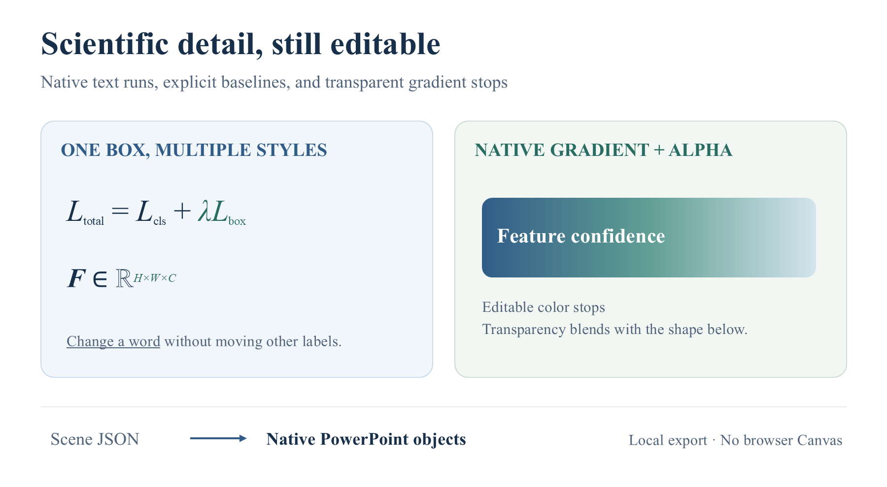

# Scientific text and transparent gradients

An original capability fixture for the local exporter, created for this repository. It contains no private paper figures or external image assets.



[Editable PPTX](editable.pptx?raw=true) · [Scene JSON](../scientific-text.scene.json) · [Verification](verification.json)

- **18 native objects**, including 12 text boxes and one arrow; no picture objects.
- Three rich text boxes retain mixed styles in a single shape. Try selecting the loss label and editing only its subscript.
- Superscripts/subscripts use native text baseline offsets and explicit sizes. They are not native equation objects.
- The green/blue fill uses three native gradient stops with individual opacity, blending with an underlying shape.
- The caption uses explicit line spacing. No browser or font-fitting step is involved.

The PPTX was opened and rendered by Microsoft PowerPoint, and a separate edit-probe copy successfully changed text, moved a shape and recolored an arrow. A second probe selected the `total` subscript, verified its 14.4-point size and negative baseline, changed it to `all`, saved and reopened the copy with all 18 objects retained. The independent audit checked object structure, text formatting and gradient semantics. This fixture verifies supported export behavior, not recognition accuracy on unseen figures.

Reproduce from the repository root:

```bash
node scripts/export_pptx.mjs --scene examples/scientific-text.scene.json --output build/scientific-text.pptx
python -X utf8 scripts/audit_pptx.py --pptx build/scientific-text.pptx --scene build/scientific-text.exported.scene.json --report build/scientific-text.audit.json
```

```powershell
powershell -NoProfile -File scripts/render_powerpoint.ps1 -InputPptx build/scientific-text.pptx -OutputPng build/scientific-text.png -Width 1800
```
